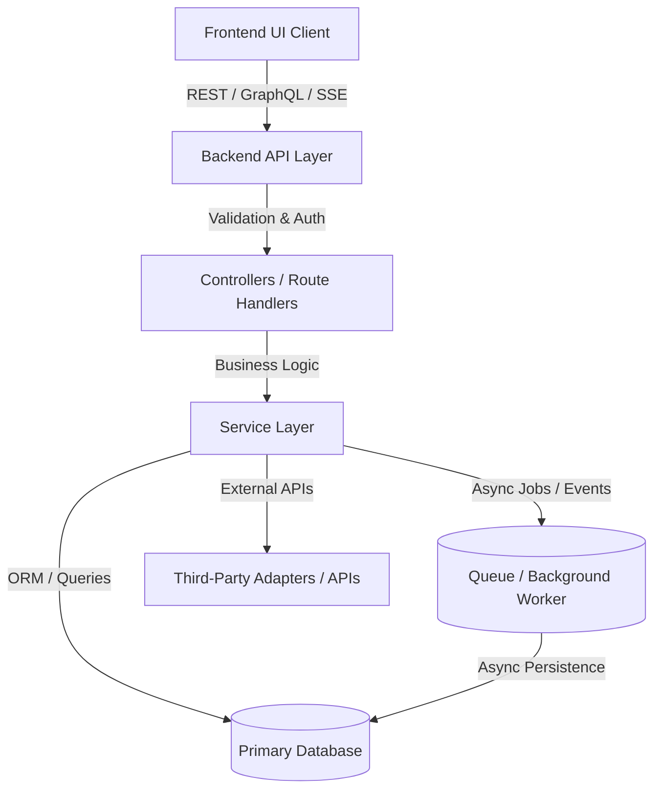

# 🏗️ Full-Stack System Architecture (Architecture.md)

**Project Name**: `[Project Name]`  
**Specification Reference**: `[Link to PRD.md or Master Spec if available]`

---

## 1. High-Level Architecture & System Flow



---

## 2. Subsystems Breakdown

### 2.1 Frontend Client Architecture
- **Framework & Runtime**: `[e.g., React 18 / Next.js / Vue + Vite]`
- **Styling & Design System**: `[e.g., TailwindCSS + Custom Tokens in Design.md]`
- **State Management**: `[e.g., React Context / Zustand / Redux Toolkit / React Query]`
- **API Communication**: `[e.g., Axios / Fetch Client with typed interceptors and error handling]`
- **Core Component System**: Centralized reusable primitives (`Button`, `DataTable`, `Modal`, `Drawer`, `StateContainer`).

### 2.2 Backend API & Service Layer
- **Framework & Runtime**: `[e.g., Node.js with Express / Fastify or Python FastAPI]`
- **Validation Layer**: `[e.g., Zod / Joi / Pydantic schema validation for request payloads]`
- **Business Logic Layer**: Modular service classes isolating business logic from HTTP transport.
- **Middleware**: Authentication, context injection, CORS, request rate limiting, and centralized error handling.

### 2.3 Database & Storage Layer
- **Primary Database**: `[e.g., PostgreSQL / MySQL / MongoDB / SQLite]`
- **ORM / Query Builder**: `[e.g., Prisma / Drizzle / TypeORM / SQLAlchemy]`
- **Indexing & Relations**: Foreign key constraints, unique indexes, and optimized query patterns.

### 2.4 Background Jobs & Asynchronous Tasks (Optional)
- **Task Queue Engine**: `[e.g., Redis + BullMQ / Celery / Native Workers]`
- **Job Flow**: Long-running jobs run asynchronously with job states: `Queued` → `Running` → `Completed` / `Failed`.
- **Telemetry**: Real-time status reporting to the frontend via polling or SSE.

### 2.5 External Integrations & Adapters
- Isolated behind clean interface adapters to ensure loose coupling and testability.

### 2.6 Android Mobile Client Architecture (droid.md)
- **UI & Presentation**: Jetpack Compose + Material 3, Navigation Compose, and sealed `UiState` modeling.
- **State & ViewModel**: Jetpack ViewModel (`viewModelScope`), read-only `StateFlow` for UI state, and `Channel` for one-time navigation events.
- **Domain Layer**: Clean Architecture UseCases / Interactors isolating business rules.
- **Data Layer (Offline-First)**: Single source of truth with Room Database (DAOs with `Flow`), DataStore preferences, and Retrofit HTTP client.
- **Dependency Injection**: Hilt (`@HiltAndroidApp`, `@AndroidEntryPoint`, `@HiltViewModel`).
- **Performance & Benchmarks**: Baseline Profile generation and Macrobenchmark optimization.

### 2.7 Python Service & API Architecture (python.md)
- **Framework & Runtime**: Python 3.11+ with FastAPI (AsyncIO) or Flask / Django.
- **Validation & Schemas**: Pydantic v2 data validation and serialized response models.
- **Data & ORM**: Async SQLAlchemy 2.0 with session factories and Alembic migrations.
- **Service Layer**: Business logic separated cleanly into services and repository classes.
- **Testing & Safety**: Pytest with `pytest-asyncio` and `httpx.AsyncClient`.

---

## 3. Standard Portable Directory Structure

```
.
├── .agent/
│   ├── skills/                      # AI Agent Skills (webstack, droid, python, motion, seo, ui-ux-pro-max)
│   └── workflows/
│       ├── webstack.md              # Master Web Development Protocol
│       ├── webstack-frontend.md     # Web Frontend Protocol
│       ├── webstack-backend.md      # Web Backend Protocol
│       ├── droid.md                 # Master Android Development Protocol
│       ├── droid-ui.md              # Android Compose UI & M3 Protocol
│       ├── droid-architecture.md    # Android Clean Architecture & Data Protocol
│       ├── baseline-profile.md      # Android Performance & Benchmark Protocol
│       ├── python.md                # Master Python Development Protocol
│       ├── python-api.md            # Python FastAPI & Schema Protocol
│       ├── python-architecture.md   # Python Clean Architecture & Data Protocol
│       ├── PRD.md                   # Product Requirements Document
│       ├── Architecture.md          # System Architecture & Diagrams
│       ├── Rules.md                 # Strict Execution Rules & Boundaries
│       ├── Phases.md                # Development Roadmap & Phases
│       ├── Design.md                # UI Design Tokens & Theme Specs
│       ├── Memory.md                # Persistent System Context & State
│       └── done.md                  # Completed Tasks Audit Log
├── app/                             # Python or Android Application Source
│   ├── api/                         # FastAPI Routers & Endpoints (Python)
│   ├── core/                        # Config, Settings, Security (Python)
│   ├── db/                          # SQLAlchemy Base & Session Factory (Python)
│   ├── models/                      # SQLAlchemy 2.0 ORM Models (Python)
│   ├── schemas/                     # Pydantic v2 Validation Schemas (Python)
│   ├── repositories/                # Async Database Repositories (Python)
│   ├── services/                    # Business Logic Services (Python)
│   ├── src/main/java/com/.../       # Jetpack Compose & Hilt Code (Android)
│   └── main.py                      # Application Entrypoint (Python)
├── alembic/                         # Database Schema Migrations (Python)
├── pyproject.toml                   # Python Dependencies Configuration (python.md)
├── baselineprofile/                 # Android Baseline Profile & Macrobenchmarks
├── frontend/                        # Frontend Web Application Source (webstack.md)
│   ├── src/
│   │   ├── api/                     # Typed API client & request wrappers
│   │   ├── components/              # Centralized reusable UI components
│   │   ├── context/                 # Application & theme context providers
│   │   ├── hooks/                   # Custom reusable frontend hooks
│   │   ├── pages/                   # Application route views & screens
│   │   ├── types/                   # Frontend TypeScript interfaces
│   │   ├── App.tsx                  # Root layout & routing configuration
│   │   └── index.css                # Base styling & Tailwind tokens
├── backend/                         # Backend Application Source (webstack.md)
│   ├── src/
│   │   ├── config/                  # DB connection, environment variables
│   │   ├── controllers/             # HTTP route handlers
│   │   ├── middleware/              # Auth, validation, error handlers
│   │   ├── routes/                  # API route definitions
│   │   ├── services/                # Core business logic services
│   │   ├── types/                   # Backend types & data interfaces
│   │   └── server.ts                # Application entry point
│   ├── prisma/                      # Database schema & migrations
│   └── package.json
└── README.md
```

---

## 4. Security & Data Integrity Protocol

### 4.1 Web & API Security Layer
1. **SSRF & Network Safety**: All outbound HTTP fetchers must validate destinations and block internal/private ranges (`127.0.0.1`, `10.0.0.0/8`, `192.168.0.0/16`, `169.254.169.254`).
2. **Secrets Protection**: Credentials and API keys stay exclusively in backend `.env` files; zero client bundle exposure.
3. **CORS Policy**: Restrict CORS origins explicitly in production. Do not combine wildcard `*` with `AllowCredentials=true`.
4. **Cookie Security**: Auth cookies must have `HttpOnly`, `Secure`, and `SameSite=Lax` (or `Strict`) flags.

### 4.2 Android Mobile Security Layer (droid.md)
1. **Cleartext Blocking**: Enforce `android:usesCleartextTraffic="false"` in `AndroidManifest.xml` to mandate HTTPS/TLS.
2. **Data-at-Rest Encryption**: Sensitive tokens/keys must be stored using `EncryptedSharedPreferences` (Jetpack Security) or Android Keystore.
3. **Extraction & Backup Protection**: Set `android:allowBackup="false"` to prevent adb backup extraction of private data.
4. **Code Obfuscation**: Enable R8 / ProGuard minification (`isMinifyEnabled = true`, `isShrinkResources = true`) in release builds.

### 4.3 Python Service & Database Safety (python.md)
1. **Parameterized Queries**: Zero raw string SQL concatenation. All queries use async SQLAlchemy 2.0 ORM or parameterized bindings to eliminate SQL injection.
2. **Strong Cryptography**: Passwords hashed using `bcrypt` (work factor >= 12) or Argon2.
3. **Type & Schema Validation**: Pydantic v2 schemas reject unexpected fields and enforce type constraints on all request payloads.
4. **Multi-Tenancy Scoping**: Enforce workspace / user ownership scoping across all database queries and resource lookups (`WHERE user_id = :auth_user_id`).
