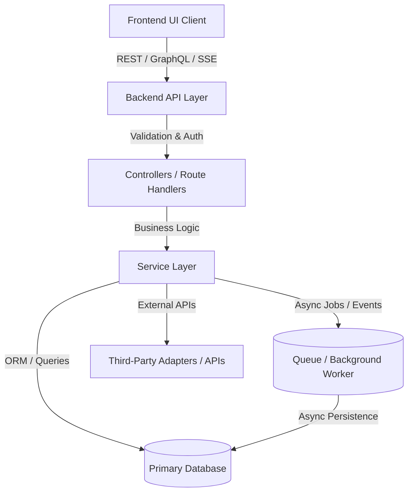

# 🏗️ Full-Stack System Architecture (Architecture.md)

**Project Name**: `[Project Name]`  
**Specification Reference**: `[Link to PRD.md or Master Spec if available]`

---

## 1. High-Level Architecture & System Flow



---

## 2. Subsystems Breakdown

### 2.1 Frontend Client Architecture
- **Framework & Runtime**: `[e.g., React 18 / Next.js / Vue + Vite]`
- **Styling & Design System**: `[e.g., TailwindCSS + Custom Tokens in Design.md]`
- **State Management**: `[e.g., React Context / Zustand / Redux Toolkit / React Query]`
- **API Communication**: `[e.g., Axios / Fetch Client with typed interceptors and error handling]`
- **Core Component System**: Centralized reusable primitives (`Button`, `DataTable`, `Modal`, `Drawer`, `StateContainer`).

### 2.2 Backend API & Service Layer
- **Framework & Runtime**: `[e.g., Node.js with Express / Fastify or Python FastAPI]`
- **Validation Layer**: `[e.g., Zod / Joi / Pydantic schema validation for request payloads]`
- **Business Logic Layer**: Modular service classes isolating business logic from HTTP transport.
- **Middleware**: Authentication, context injection, CORS, request rate limiting, and centralized error handling.

### 2.3 Database & Storage Layer
- **Primary Database**: `[e.g., PostgreSQL / MySQL / MongoDB / SQLite]`
- **ORM / Query Builder**: `[e.g., Prisma / Drizzle / TypeORM / SQLAlchemy]`
- **Indexing & Relations**: Foreign key constraints, unique indexes, and optimized query patterns.

### 2.4 Background Jobs & Asynchronous Tasks (Optional)
- **Task Queue Engine**: `[e.g., Redis + BullMQ / Celery / Native Workers]`
- **Job Flow**: Long-running jobs run asynchronously with job states: `Queued` → `Running` → `Completed` / `Failed`.
- **Telemetry**: Real-time status reporting to the frontend via polling or SSE.

### 2.5 External Integrations & Adapters
- Isolated behind clean interface adapters to ensure loose coupling and testability.

---

## 3. Standard Portable Directory Structure

```
.
├── .agent/
│   └── workflows/
│       ├── webstack.md              # Master Development Protocol
│       ├── webstack-frontend.md     # Frontend Protocol
│       ├── webstack-backend.md      # Backend Protocol
│       ├── PRD.md                   # Product Requirements Document
│       ├── Architecture.md          # System Architecture & Diagrams
│       ├── Rules.md                 # Strict Execution Rules & Boundaries
│       ├── Phases.md                # Development Roadmap & Phases
│       ├── Design.md                # UI Design Tokens & Theme Specs
│       ├── Memory.md                # Persistent System Context & State
│       └── done.md                  # Completed Tasks Audit Log
├── frontend/                        # Frontend Application Source
│   ├── src/
│   │   ├── api/                     # Typed API client & request wrappers
│   │   ├── components/              # Centralized reusable UI components
│   │   ├── context/                 # Application & theme context providers
│   │   ├── hooks/                   # Custom reusable frontend hooks
│   │   ├── pages/                   # Application route views & screens
│   │   ├── types/                   # Frontend TypeScript interfaces
│   │   ├── App.tsx                  # Root layout & routing configuration
│   │   └── index.css                # Base styling & Tailwind tokens
├── backend/                         # Backend Application Source
│   ├── src/
│   │   ├── config/                  # DB connection, environment variables
│   │   ├── controllers/             # HTTP route handlers
│   │   ├── middleware/              # Auth, validation, error handlers
│   │   ├── routes/                  # API route definitions
│   │   ├── services/                # Core business logic services
│   │   ├── types/                   # Backend types & data interfaces
│   │   └── server.ts                # Application entry point
│   ├── prisma/                      # Database schema & migrations
│   └── package.json
└── README.md
```

---

## 4. Security & Data Integrity Protocol
1. **SSRF & Network Safety**: Scrapers or external fetchers must block private IP ranges (`127.0.0.1`, `10.x`, `192.168.x`).
2. **Secrets Protection**: Credentials and API keys must stay in backend `.env` files; zero client exposure.
3. **Multi-Tenancy / Scoping**: Database queries must be scoped to the authenticated workspace or user context.
